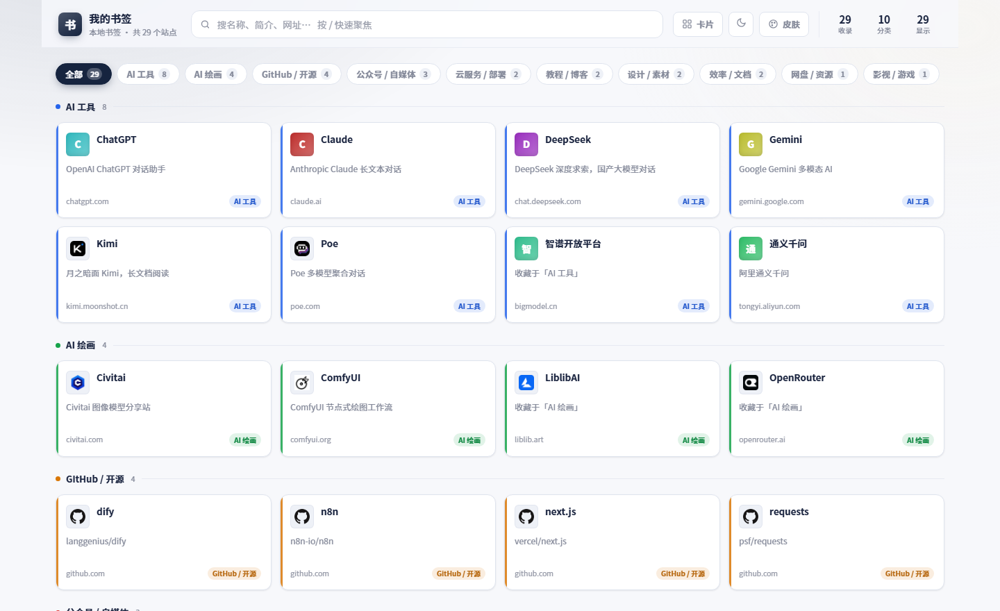
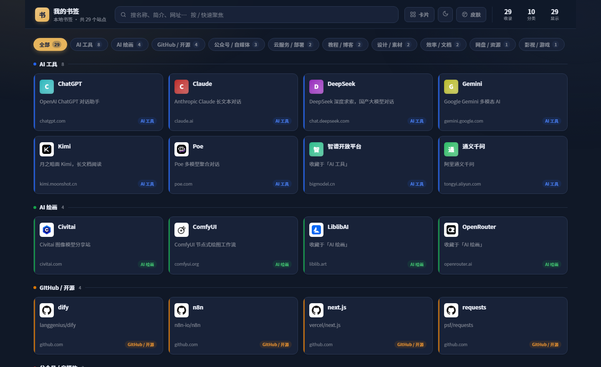
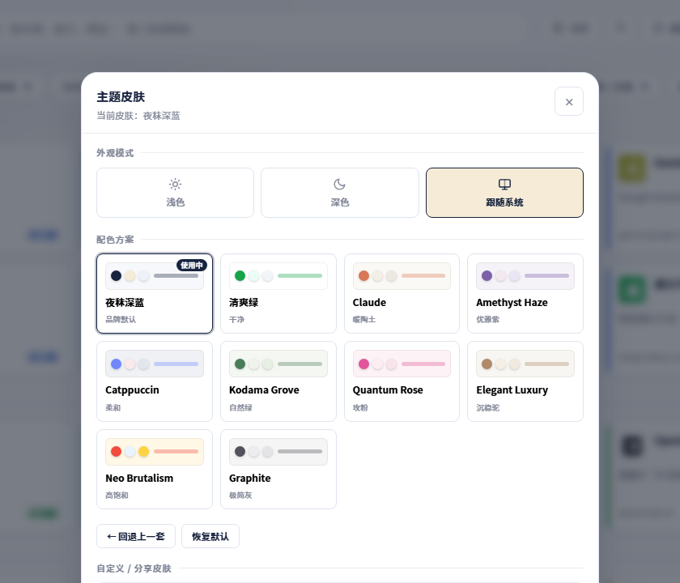

<div align="center">


# 夜秣浏览器书签本地整理

**把浏览器里那堆书签，变成一页能搜、能筛、能换皮肤的卡片导航。**

不上传 · 不联网 · 不需要账号 · 不需要服务器 · 单文件双击即用

[](https://skillhub.cn/skills/yemo-bookmark-local)
[](LICENSE)
[](#一本地保存本地操作一步都不出本机)

</div>

---

## 这个技能的两个特点

### 一、本地保存、本地操作，一步都不出本机

这不是「我们承诺不收集」，而是**根本没有联网上传这一步**：

| 环节 | 联网？ | 说明 |
|---|---|---|
| 解析书签 | ❌ | Python 标准库在自己电脑上读文件 |
| 分类、简介、图标 | ❌ | 规则与数据全部写在本地脚本里 |
| 生成页面 | ❌ | CSS / JS / 数据全内联进一个 HTML |
| 打开页面 | ❌ | 图标用导出文件自带的 base64，断网也有 |
| 换皮肤 | ❌ | 纯前端 CSS 变量，偏好只存你自己的浏览器 |

整个流程没有 API 调用、没有账号、没有服务端。**书签里往往有内网地址、后台链接、私人收藏 —— 这些东西不该经过任何第三方服务器，包括 AI 助手的。**

想验证？断网跑一遍就知道：

```bash
python scripts/generate.py bookmarks.html -o 我的书签.html --name "我的书签"
```

### 二、有一步需要你自己动手：先把书签导出来

这是整个流程唯一的门槛 —— 技能没法替你去点浏览器。所以流程是：**你导出一次 → 丢给技能 → 剩下全自动**。

| 浏览器 | 导出路径 |
|---|---|
| Chrome | `⋮` → 书签 → 书签管理器 → 右上 `⋮` → 导出书签 |
| Edge | `…` → 收藏夹 → 管理收藏夹 → 右上 `…` → 导出收藏夹 |
| Firefox | 书签 → 管理书签 → 导入和备份 → 导出 HTML |

产物叫 `bookmarks_2026_11_1.html` 这种名字，通常落在下载目录。多个浏览器就分别导出、分别生成。

---

## 长什么样

<div align="center">

</div>

<div align="center">

</div>

<div align="center">

</div>

---

## 用它

```bash
python scripts/generate.py <书签文件.html> -o <输出.html> --name "夜秣的书签"
```

| 参数 | 说明 |
|---|---|
| `--name` / `--title` | 页面名字，同时决定标题和图标用字。不填会交互式问 |
| `--mark` | 指定图标用哪个字，覆盖自动推导 |
| `--mark-color` | 图标底色，如 `#e94b8a`；默认跟随皮肤主色 |
| `--mark-hue` | 图标底色色相 `0-360` |
| `-o` | 输出路径 |
| `--skin` | 默认皮肤，默认 `yemo-navy` |
| `--icons` | `auto`（默认）/ `inline` / `direct` / `favicon-im` / `google` / `none` |
| `--desc` | 补充简介 JSON：`{"域名": "一句话简介"}` |
| `--gh` | GitHub 仓库简介 JSON：`{"owner/repo": "简介"}` |

跑完：

```
[OK] 名称「夜秣的书签」，图标「秣」
[OK] 整理了 744 个站点，15 个分类
[OK] 输出：D:\书签\我的书签.html
```

## 名字决定图标

页面名字是问出来的，图标字是从名字自动推出来的 —— 任何人填自己的名字，出来的就是他自己的一页，不用改代码。

| 名字 | 图标字 | 规则 |
|---|---|---|
| 夜秣的书签 | **秣** | 去掉「的书签」取末字 |
| 马总的书签 | **马** | 先剥敬称「总/哥/姐/老师」再取字 |
| 老王收藏夹 | **王** | 去掉「收藏夹」取末字 |
| Lin's Bookmarks | **L** | 英文取首字母 |
| 我的书签 | **书** | 太泛的词回落成「书」 |

图标底色默认跟随皮肤主色，切皮肤它会一起变；也可以用 `--mark-color` 钉死一个色。

## 为什么分类看着还挺准

浏览器导出的书签里，文件夹名是最准的分类依据 —— 有就优先用它，「书签栏 / 其他书签 / 已导入」这类根目录则跳过。

没有可用的文件夹时，走**域名 + 标题打分**：域名命中记 3~5 分（域名越长越精确，`cloud.tencent.com` 不会被 `tencent` 这种泛规则抢走），标题关键词记 1 分，取得分最高的分类。内置 14 类：

`GitHub / 开源`、`AI 检测 / 降重`、`AI 对话 / 助手`、`AI 绘画 / 提示词`、`AI 中转 / API`、
`公众号 / 自媒体`、`代理 / 网络工具`、`云服务 / 部署`、`网盘 / 资源搜索`、`教程 / 博客 / 论坛`、
`影视 / 游戏`、`设计 / 素材`、`效率 / 文档`、`购物 / 生活`

实测一份 817 条的真实书签：去重后 744 条，`其他` 只剩 17%，剩下的都归好了位。

## 图标一个请求都不发

Chrome / Edge 导出的书签 HTML 里，大部分链接自带 `ICON="data:image/png;base64,..."`。默认策略是**优先用这些自带图标** —— 于是断网、内网、飞机上都能看到图标。

| 模式 | 行为 |
|---|---|
| `auto`（默认） | 自带图标优先，没有的才联网抓 |
| `inline` | 只用自带图标，绝对零请求 |
| `direct` | 全部去站点根目录取 `favicon.ico` |
| `none` | 全用首字母色块 |

深色模式下会自动给图标垫一层浅底板 —— 不然 GitHub、终端类工具的黑图标会糊进背景。

## 十套皮肤

`夜秣深蓝`（默认）、`清爽绿`、`Claude`、`Amethyst Haze`、`Catppuccin`、`Kodama Grove`、`Quantum Rose`、`Elegant Luxury`、`Neo Brutalism`、`Graphite`

每套都有浅色 + 深色两层，另有三档外观模式（浅色 / 深色 / 跟随系统）。皮肤可以导出成 JSON 分享给别人，导入时带安全校验：键名白名单 + 值字符白名单 + 危险模式拦截（`url()` / `expression()` / `javascript:` / 分号一律丢弃），粘来路不明的主题也搞不坏页面。

细节见 [`references/换肤原理.md`](references/换肤原理.md)。

## 文件结构

```
yemo-bookmark-local/
├── SKILL.md                  技能主文档（含完整使用流程）
├── scripts/generate.py       书签解析 + 分类 + 名字/图标推导 + 页面组装
├── assets/app.css            皮肤驱动的样式层（全 CSS 变量）
├── assets/theme-engine.js    换肤引擎（10 套皮肤 / 导入导出 / 消毒 / 回退）
├── assets/app-engine.js      卡片渲染（双视图 / 搜索高亮 / 筛选 / 主题面板）
└── references/换肤原理.md     想改皮肤体系时看这个
```

## 边界

- **只放行 http/https 链接**：`javascript:`、`place:`、`data:` 这类书签小工具会被过滤。
- **同址去重**：同一个 URL 收藏多次只留第一条。
- **数据嵌在 HTML 里**：所以单文件可离线、可发给别人；反过来说，**别把含私密地址的页面随手发出去**。
- **页面已 `noindex`**：不会被搜索引擎收录。

## 版权

夜秣原创 · MIT

换肤体系沿用业界通行的 CSS 变量主题约定（`--background` / `--foreground` / `--primary` / `--card` / `--border` / `--radius` 这套 shadcn 风格命名），按离线单文件场景重写，并自行增加了导入安全消毒、快照回退、图标兜底、名字与图标自动推导等改造。书签解析、分类归组、卡片渲染、简介库均为本项目自研。
